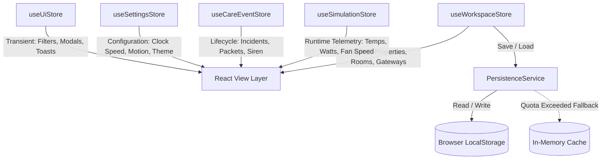

# SmartAir Simulator — Architectural Overview

This document describes the software design, state management, simulation pipeline, and decoupled domain architecture of the **SmartAir Interactive Digital-Twin Simulator**.

---

## 1. High-Level Architectural Principles

1. **Client-Side Digital Twin**:
   - The entire simulation runs 100% inside modern web browsers with zero backend or cloud requirements.
   - All state persists to `localStorage` via a typed repository service with automatic fallback to in-memory storage if storage quotas are exceeded or private browsing restrictions apply.
2. **Dual-Edition Domain Segregation**:
   - **SmartAir Smart Home Edition**: Focuses on indoor thermal dynamics, evaporative cooling offset, quiet acoustic limits, vacancy cut-off, and side-by-side comparative Energy Lab modeling.
   - **SmartAir Smart Care Edition**: Focuses on institutional abnormal-load detection, edge latching, simulated RF packet transmission to a shared building gateway, building siren coordination, and warden administrative auditing.
3. **Deterministic Discrete Simulation Engine**:
   - Discrete fixed-step physics integration ensures reproducible demonstrations across presentations and evaluations.
   - Simulation time runs on a unified `SimulationClock` controller with configurable multiplier speeds (1×, 5×, 20×) and deterministic step advancing (`+1 Min`).

---

## 2. Directory Structure & Layering

```
SmartAir/
├── public/                 # Static assets, SVG favicons
├── src/
│   ├── components/         # Modular React UI presentation components
│   │   ├── admin/          # Warden console, event tables, action dialogs
│   │   ├── app-shell/      # Left navigation rail, top bar, simulation badges
│   │   ├── common/         # Atomic UI primitives (MetricCard, StatusBadge, Toast, Dialogs)
│   │   ├── energy-lab/     # Recharts analytics, comparative KPI cards, assumption callouts
│   │   ├── forms/          # Add Room 4-step wizard forms
│   │   ├── network/        # Interactive node-link topology diagram, packet drawer, RF logs
│   │   ├── room-scene/     # 2.5D Isometric SVG room scene, ceiling fan spin, virtual load
│   │   ├── simulator/      # Simulation toolbar, timeline, decision logs, scenario modal
│   │   ├── smart-care/     # Load drag/keyboard controls, incident progression pipeline
│   │   └── smart-home/     # Fan controls, thermostat, comfort cards, occupancy switches
│   ├── domain/             # Pure TypeScript domain types, constants, schemas, ID generators
│   │   ├── constants.ts    # Power tables, thermal parameters, hysteresis bounds
│   │   ├── events.ts       # Discriminated union domain events for the decision audit feed
│   │   ├── ids.ts          # Deterministic and random ID utilities (slugify, UUID generators)
│   │   ├── schemas.ts      # Strict Zod schemas and foreign-key cross-validation
│   │   └── types.ts        # Comprehensive domain interfaces and entity definitions
│   ├── hooks/              # Custom React hooks (useSimulationClock)
│   ├── pages/              # Top-level view routes (Overview, Rooms, Simulator, Network, Admin, etc.)
│   ├── router/             # React Router v7 configuration and route definitions
│   ├── services/           # Decoupled persistence, demo seeding, export, import services
│   ├── simulation/         # Core physics, control heuristics, and network simulators
│   │   ├── clock.ts        # Pure TypeScript SimulationClock class
│   │   ├── scenarios.ts    # 11 pre-packaged demonstration presets and applyScenario engine
│   │   ├── smart-care/     # Abnormal-load detection, RF radio, gateway, siren simulator
│   │   └── smart-home/     # Thermal model, humidity model, comfort index, energy model
│   ├── state/              # Zustand state stores and memoized selectors
│   │   ├── selectors.ts    # Computed workspace KPI aggregates
│   │   ├── useCareEventStore.ts # Incidents, stages, radio packets, siren state
│   │   ├── useSettingsStore.ts  # Defaults, accessibility options, theme
│   │   ├── useSimulationStore.ts# Room runtime telemetry, timeseries, decision logs, faults
│   │   ├── useUiStore.ts   # Active tabs, search filters, toasts, modal visibility
│   │   └── useWorkspaceStore.ts # Room registry, gateway mappings, persistence lifecycle
│   └── styles/             # CSS design tokens, animations, and Tailwind directives
├── docs/                   # System documentation, mathematical models, demo guides
└── tests/                  # Vitest unit tests, React component tests, Playwright E2E tests
    ├── component/          # Component interaction tests
    ├── e2e/                # Playwright user journeys
    └── unit/               # Domain logic and physics tests
```

---

## 3. State Management Architecture

The application state is partitioned across 5 dedicated Zustand stores:



### Store Boundaries:
1. **`useWorkspaceStore`**:
   - Holds static entity registries (`rooms`, `gateways`, `properties`).
   - Manages CRUD operations, soft archival (`archivedAt`), duplication, and foreign-key validation.
2. **`useSimulationStore`**:
   - Manages the active room's runtime environment.
   - Bounded timeseries buffer (capped at 1,000 points to prevent browser memory leaks).
   - Structured decision event logs (capped at 300 entries).
   - Fault injection toggles (`radioFault`, `gatewayFault`, `sirenFault`, `localAlarmFault`).
3. **`useCareEventStore`**:
   - Tracks abnormal-load incidents from detection through resolution.
   - Radio packet queue and latency timers.
   - Global shared building siren state and individual local room buzzer states.
4. **`useSettingsStore`**:
   - Preserves user preferences: clock speed, reduce motion flag, default vacancy timer, default threshold.
5. **`useUiStore`**:
   - Manages UI filter bars, navigation drawer states, and auto-dismissing notifications (toasts).

---

## 4. Simulation Execution Pipelines

### Smart Home Control Loop:
1. **Thermal Physics Integration**:
   $$T_{indoor}(t + \Delta t) = T_{indoor}(t) + \dot{Q}_{envelope}\Delta t - \dot{Q}_{cooling}\Delta t$$
2. **Control Rules Evaluation**:
   - Evaluates AC thermostat hysteresis band ($\pm 0.5^\circ\text{C}$).
   - Adjusts BLDC fan speed based on thermal demand.
   - Enforces acoustic Quiet Mode ceiling cap (fan restricted to Low).
   - Manages 60-second vacancy cut-off countdown.
3. **Comfort Calculation**:
   - Computes perceived convective cooling depression ($\Delta T_{perceived} \le 2.5^\circ\text{C}$).
   - Applies relative humidity penalty.
   - Computes bounded 0–100 illustrative comfort score.
4. **Energy Accumulation**:
   $$\text{kWh} = \frac{P_{fan} + P_{cooling}}{1000} \cdot \Delta t_{hours}$$

### Smart Care Abnormal-Load Pipeline:
```
[Virtual Mass > Threshold]
           │
           ▼
[Edge Load Crossing Detection] ──> (Buzzer Sounded Locally)
           │
           ▼ (if Radio online)
[Radio Packet Dispatch] ──> [Simulated Latency ~750ms]
           │
           ▼ (if Gateway online)
[Gateway Room Lookup] ──> [Maps Packet to Room & Property]
           │
           ▼ (if Siren output online)
[Building Siren Sounds] ──> [Warden Admin Console Alert]
                                    │
                                    ├──> [Warden Acknowledges] (Silences local alarms)
                                    └──> [Warden Resolves] (Closes incident with audit note)
```

---

## 5. Security, Resilience & Privacy Safeguards

- **Strict Isolation**: No external network requests, third-party analytics, or tracking scripts.
- **Zero Real Hardware Risk**: All siren previews are synthetic browser AudioContext beeps strictly initiated by user clicks.
- **Safe JSON Import**: Imported workspace backups are sanitized through Zod schema validation and cross-entity foreign key referential integrity checks before reaching application state.
